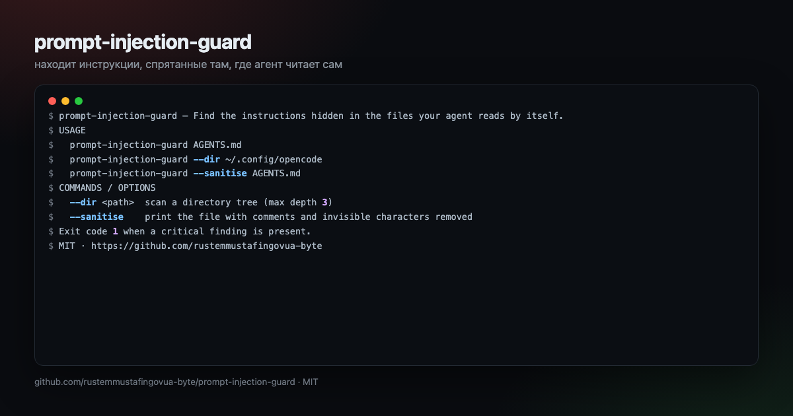

<div align="center">



# prompt-injection-guard

**Find the instructions hidden in the files your agent reads by itself.**

[](https://github.com/rustemmustafingovua-byte/prompt-injection-guard/actions/workflows/ci.yml)
[](https://www.npmjs.com/package/prompt-injection-guard)
[](./LICENSE)
[](https://nodejs.org)
[](https://base.org)

[**Docs**](https://rustemmustafingovua-byte.github.io/prompt-injection-guard/) · [Issues](https://github.com/rustemmustafingovua-byte/prompt-injection-guard/issues) · [Discussions](https://github.com/rustemmustafingovua-byte/prompt-injection-guard/discussions)

</div>

---

Agents read rules files, tool descriptions and documentation without a human in the loop. prompt-injection-guard scans the places an agent reads automatically for hidden instructions, invisible characters and embedded commands — and can sanitise them.

## Install

```bash
# tarball из релиза: без токена и без npm-логина
npm i -g https://github.com/rustemmustafingovua-byte/prompt-injection-guard/releases/download/v0.1.0/prompt-injection-guard-0.1.0.tgz
```

<details>
<summary>Через GitHub Packages (нужен токен со scope read:packages)</summary>

```bash
npm i -g @rustemmustafingovua-byte/prompt-injection-guard --registry=https://npm.pkg.github.com
```

</details>
## What it does

| | |
|---|---|
| **Ten injection patterns** | override, exfiltration, hidden comments, role spoofing |
| **Invisible characters** | zero-width and bidi control characters |
| **Directory scanning** | rules, skills, configs, docs |
| **Sanitising mode** | strip comments and invisible characters |


## Usage

```bash
prompt-injection-guard AGENTS.md
prompt-injection-guard --dir ~/.config/opencode
prompt-injection-guard --sanitise AGENTS.md
```

## CLI

```
prompt-injection-guard — Find the instructions hidden in the files your agent reads by itself.

USAGE
  prompt-injection-guard AGENTS.md
  prompt-injection-guard --dir ~/.config/opencode
  prompt-injection-guard --sanitise AGENTS.md

COMMANDS / OPTIONS
  --dir <path>  scan a directory tree (max depth 3)
  --sanitise    print the file with comments and invisible characters removed

Exit code 1 when a critical finding is present.

MIT · https://github.com/rustemmustafingovua-byte
```

## Part of a portfolio

| Project | What it does |
|---|---|
| [`opencode-free-stack`](https://github.com/rustemmustafingovua-byte/opencode-free-stack) | route to free models, fall back automatically |
| [`free-web-mcp`](https://github.com/rustemmustafingovua-byte/free-web-mcp) | web search for agents, zero credits |
| [`agent-x402`](https://github.com/rustemmustafingovua-byte/agent-x402) | pay per API call in USDC with a spend policy |

## Donate

MIT, forever. USDC on Base:

```
0x8aC6a229f254980CCd3Dd35CF5E1B7c08880B40E
```

## Support

Every tool here is MIT and free. If it saved you time, you can support the work:

- **USDC (Base):** `0x8aC6a229f254980CCd3Dd35CF5E1B7c08880B40E`
- **GitHub Sponsors:** https://github.com/sponsors/rustemmustafingovua-byte

Paid tiers of the hosted services are billed per call in USDC (x402) — no accounts, no keys.

## License

MIT © rustemmustafingovua-byte
